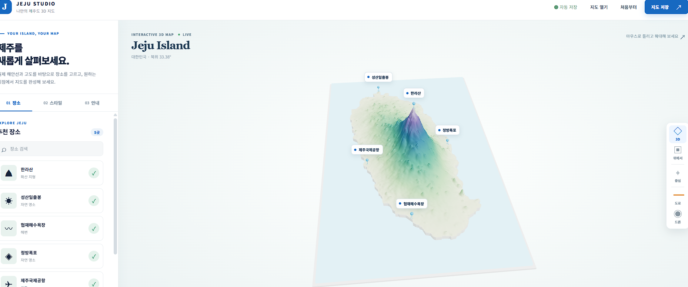

# Jeju Island 3D



Interactive 3D Jeju Island planner built with Three.js. It renders the island outline and terrain, lets visitors add places, adjust terrain styling, and save or restore a map as JSON.

## Run locally

Serve this directory with any static web server, then open `index.html`.

```bash
python3 -m http.server 8080
```

## Included files

- `index.html` — application markup
- `jeju-planner.js` — Three.js scene and planner interaction
- `jeju-planner.css` — responsive UI styling
- `assets/` — island outline and embedded terrain textures
- `vendor/` — local Three.js and OrbitControls dependencies
- `scripts/build_jeju_assets.py` — asset-generation utility

Terrain reference data: Natural Earth and Mapzen Terrain Tiles (SRTM/USGS).
